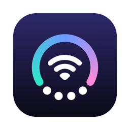
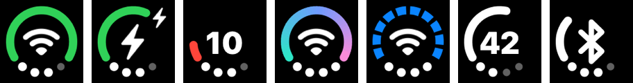
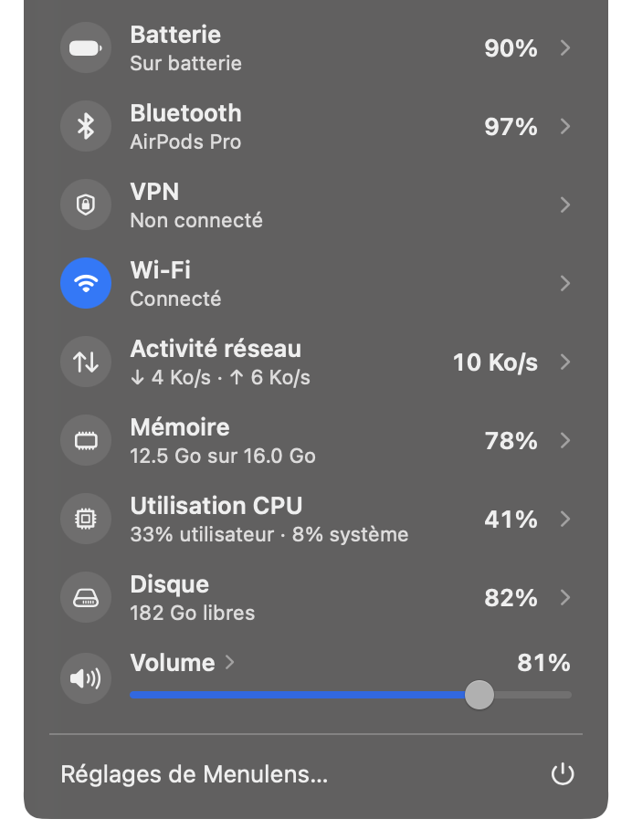
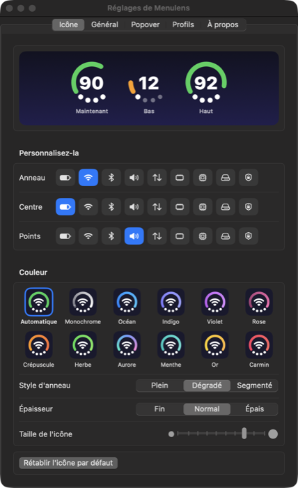
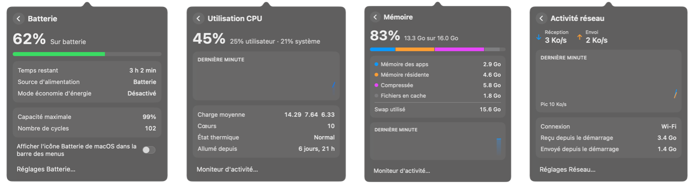

<p align="center">
  
</p>

<h1 align="center">Menulens</h1>

<p align="center">
  <b>Votre barre des menus, en une seule icône.</b><br>
  Une app macOS gratuite et open source qui regroupe batterie, Wi-Fi, Bluetooth, VPN, son, réseau, mémoire, CPU et disque dans une seule icône de la barre des menus.
</p>

<p align="center">
  macOS 14+ · Swift / SwiftUI · aucune dépendance · aucune requête réseau
</p>

---

## Le principe

La barre des menus se remplit vite : batterie, Wi-Fi, Bluetooth, son, VPN, moniteurs système… Menulens remplace tout ça par **une seule icône** composée de trois zones que vous choisissez :

- **l'anneau** : un arc de 240° qui se remplit selon une mesure (ex. la force du Wi-Fi) ;
- **le centre** : un symbole ou une valeur (ex. le pourcentage de batterie) ;
- **les points** : quatre points sous l'icône pour une troisième mesure (ex. le volume).

<p align="center">
  
</p>

Un clic ouvre un popover qui détaille chaque mesure. Au survol, l'icône peut aussi **se déplier** en icônes séparées :

<p align="center">
  
</p>

## Captures d'écran

| Popover | Réglages |
|:---:|:---:|
|  |  |

Pages de détail (batterie, CPU, mémoire, réseau) :



## Fonctionnalités

**Mesures**
- **Batterie** : niveau, charge, temps restant, source d'alimentation, mode économie d'énergie, capacité maximale, nombre de cycles.
- **Wi-Fi** : réseau, signal, débit, bande ; liste des réseaux alentour, connexion et déconnexion, activation du Wi-Fi.
- **Bluetooth** : appareils jumelés, batterie des AirPods (gauche / droite / boîtier) et des souris, claviers et trackpads ; connexion et déconnexion.
- **VPN** : tous les VPN de Réglages Système, y compris les VPN d'apps (ProtonVPN, Tailscale…) et les VPN IKEv2 intégrés. Connexion et déconnexion en un clic.
- **Son** : volume, muet, choix de la sortie audio.
- **Réseau** : débit montant et descendant, graphique de la dernière minute, total depuis le démarrage.
- **Mémoire**, **CPU** (charge moyenne, cœurs, état thermique, temps depuis le démarrage) et **disque**.

**Personnalisation**
- 12 palettes de couleurs, 3 styles d'anneau (plein, dégradé, segmenté), 3 épaisseurs, taille de l'icône réglable.
- **Profils** : enregistrez plusieurs configurations (Travail, Voyage…) et passez de l'une à l'autre depuis le popover.
- Ordre et visibilité des rangées du popover réglables par glisser-déposer.

**Le reste**
- **Moments en direct** : l'icône montre brièvement ce qui vient de se passer (branchement du chargeur, connexion des AirPods, batterie faible, perte du réseau, changement de volume, VPN connecté).
- **Icônes système** : masquez ou réaffichez les icônes Wi-Fi, Bluetooth, batterie, son et VPN de macOS, directement depuis Menulens.
- **Français et anglais** (suit la langue du système ou se règle à la main).
- Ouverture automatique à la connexion.

## Installation

Menulens n'est pas distribué en binaire signé : on le compile soi-même (2 minutes).

**Prérequis** : macOS 14 ou plus récent, Xcode ou les Command Line Tools (Swift 5.10+).

```bash
git clone https://github.com/flynnslegacy/menulens.git
cd menulens
scripts/build-app.sh            # crée build/Menulens.app
scripts/build-app.sh --install  # ou : copie dans /Applications et lance l'app
```

Au premier lancement, macOS demande l'accès au **Bluetooth** (pour lister les appareils). Pour afficher le nom des réseaux Wi-Fi, il faut aussi autoriser la **localisation** : macOS traite les noms de réseaux comme des données de localisation.

L'app étant signée localement (« ad hoc »), macOS peut redemander ces autorisations après une recompilation.

**Tests** :

```bash
swift test
```

## Fonctionnement

### Architecture

```
src/
├── MenulensCore/        Logique pure, sans dépendance système (testée)
│   ├── Metric, MarkConfiguration, Palette, MarkGeometry
│   ├── Formatters, Localization, FrenchStrings
│   └── VPNConnection (lecture de scutil et de la configuration NetworkExtension)
└── Menulens/            L'application
    ├── App/         Point d'entrée, délégué, réglages (UserDefaults)
    ├── Services/    Une source de données par mesure
    ├── MenuBar/     Dessin de l'icône, animation, moments en direct
    ├── Popover/     Pages SwiftUI du popover
    └── Preferences/ Fenêtre de réglages
tests/MenulensCoreTests  Tests unitaires
```

`MenulensCore` ne contient que des types et des calculs : géométrie de l'icône, palettes, formats d'unités, traductions, analyse des listes de VPN. Tout est couvert par les tests. `Menulens` branche ces types sur les API système.

### D'où viennent les données

Tout est lu localement, sur votre Mac, via les API d'Apple :

| Mesure | Source |
|---|---|
| Batterie | IOKit Power Sources et le registre `AppleSmartBattery` |
| CPU | `host_statistics` (charge par tick), `getloadavg`, `ProcessInfo.thermalState` |
| Mémoire | `host_statistics64` (`vm_statistics64`), `vm.swapusage` |
| Disque | `URLResourceValues` (capacité disponible pour un usage important) |
| Réseau | Compteurs d'octets des interfaces (`getifaddrs`) et `NWPathMonitor` |
| Wi-Fi | CoreWLAN (+ CoreLocation pour le nom des réseaux) |
| Bluetooth | IOBluetooth et le registre IOKit pour la batterie des accessoires |
| Son | CoreAudio (volume, muet, périphérique de sortie par défaut) |
| VPN | `scutil --nc` et la configuration NetworkExtension ; état et connexion via les sessions NetworkExtension |
| Icônes système | Préférences de `com.apple.controlcenter` et de `com.apple.systemuiserver` |

### Dessin et économie de ressources

- L'icône est dessinée à la main (Core Graphics) dans une `NSImage` « template » ou colorée, puis posée dans un `NSStatusItem`. Le passage entre l'icône compacte et l'icône dépliée est animé.
- Seules les mesures visibles sont relevées : une fois par seconde pour celles affichées dans l'icône, plus largement quand le popover est ouvert. Le disque et les VPN sont interrogés moins souvent.
- Les appels potentiellement bloquants (Bluetooth, scans Wi-Fi, VPN) tournent hors du thread principal.

### Notes techniques

- Menulens est une app « agent » (`LSUIElement`) : ni icône dans le Dock ni menu. Pour ouvrir les réglages, cliquez sur « Réglages de Menulens… » dans le popover, ou relancez l'app depuis le Finder.
- Le masquage des icônes système modifie les préférences du Centre de contrôle (`NSStatusItem VisibleCC …`) puis relance le Centre de contrôle (et SystemUIServer pour l'ancienne icône VPN).
- Pour les VPN IKEv2 intégrés, absents de `scutil --nc`, Menulens lit `/Library/Preferences/com.apple.networkextension.plist` (lisible par tous) et passe par les fonctions `ne_session_*` de libSystem, chargées à l'exécution. Ce sont des interfaces non documentées : elles peuvent changer d'une version de macOS à l'autre.

## Confidentialité

- Aucune analyse, aucun pistage, aucune requête réseau.
- Tout est lu sur votre Mac via les API d'Apple.
- Les réglages restent dans `UserDefaults`, sur votre Mac.

## Licence

[MIT](LICENSE)
